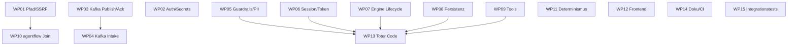

# TODO — Arbeitspakete zur Abarbeitung des Reviews

Dieses Verzeichnis enthält die aus [`../Review.md`](../Review.md) abgeleiteten **Arbeitspakete (WP)**.
Jedes WP ist so geschnitten, dass es **eigenständig** bearbeitet und **im selben File dokumentiert**
werden kann (Fortschrittslog am Ende).

## Grundregel: erst Tests, dann Änderungen

Jedes WP folgt demselben Ablauf:

1. **Tests zuerst (Red).** Bestehende Tests prüfen/erweitern, neue Testfälle für das Fehlverhalten
   schreiben. Sie müssen zunächst **fehlschlagen** (oder das heutige Fehlverhalten festhalten).
2. **Änderung (Green).** Minimale Umsetzung, bis die Tests grün sind.
3. **Verifikation.** Modul-Tests + betroffene Nachbarmodule + ggf. Integrationstests.
4. **Doku.** Changelog im WP-File, ggf. README/Doku nachziehen.

> **Referenzen** (`Bxx`, `Axx`, `Cxx`, `§x`) beziehen sich auf `../Review.md`.

## Statusübersicht

| WP | Titel | Schwere | Module | Abhängig von | Status |
|----|-------|---------|--------|--------------|--------|
| [WP01](WP01-security-path-confinement.md) | Sicherheit: Pfad-Containment & SSRF | Kritisch | quad-quarkus | – | offen |
| [WP02](WP02-security-auth-secrets-compliance.md) | Sicherheit: Auth, Secrets, Compliance | Hoch | kafka-platform, agentflow-ui | – | offen |
| [WP03](WP03-kafka-publish-ack-worker-config.md) | Kafka: Publish/Ack & Worker-Konfiguration | Kritisch | kafka-platform | – | offen |
| [WP04](WP04-kafka-intake-event-contract.md) | Kafka: Intake-/Event-Vertrag | Kritisch | kafka-platform | – | offen |
| [WP05](WP05-quad-core-guardrails-pii-observability.md) | quad-core: Guardrails, PII, Observability | Mittel | quad-core | – | offen |
| [WP06](WP06-quad-core-session-token-state.md) | quad-core: Session, Token, State | Mittel | quad-core | – | offen |
| [WP07](WP07-workflow-engine-execution-lifecycle.md) | Workflow-Engine: Ausführung & Lifecycle | Mittel | quad-quarkus | – | offen |
| [WP08](WP08-persistence-config-robustness.md) | Persistenz & Config-Robustheit | Mittel | quad-quarkus | – | offen |
| [WP09](WP09-tool-hardening.md) | Werkzeuge härten | Mittel | quad-quarkus | – | offen |
| [WP10](WP10-agentflow-generator-join.md) | agentflow: Generator konsolidieren & Join | Hoch | agentflow, quad-quarkus | WP01 (nur Testorte) | offen |
| [WP11](WP11-agentflow-determinism-request-context.md) | agentflow: Determinismus & Request-Context | Hoch | agentflow | – | offen |
| [WP12](WP12-frontend-quad-ui-agentflow-ui.md) | Frontend: quad-ui & agentflow-ui | Mittel | quad-ui, agentflow-ui | – | offen |
| [WP13](WP13-remove-dead-code.md) | Toten Code entfernen | Mittel | alle | nach WP05–WP11 | offen |
| [WP14](WP14-docs-consolidation-ci.md) | Doku konsolidieren & CI | Mittel | kafka-platform, root | – | offen |
| [WP15](WP15-integration-tests-hardening.md) | Integrationstests härten | Mittel | integration-tests | – | offen |

**Legende Status:** `offen` · `in Arbeit` · `blockiert` · `Test rot` · `fertig`

## Empfohlene Bearbeitungsreihenfolge



**Wellen:**

1. **Welle 1 – Sicherheit & Korrektheit (kritisch/hoch):** WP01, WP02, WP03, WP04, WP10, WP11.
2. **Welle 2 – Robustheit & Hygiene (mittel):** WP05, WP06, WP07, WP08, WP09.
3. **Welle 3 – Aufräumen & Prozess:** WP12, WP13, WP14, WP15 (WP13 erst nach Welle 1+2).

WP13 (toter Code) kommt **zuletzt**, damit nicht Code gelöscht wird, den ein früheres WP noch
anfassen muss.

## Test-/Build-Kommandos (Kurzreferenz)

```bash
# Root-Reaktor (alles, korrekte Reihenfolge)
mvn -T1C clean install

# quad-quarkus-Submodule
cd quad-quarkus && mvn -pl quad-core test
cd quad-quarkus && mvn -pl quad-workflow-engine test
cd quad-quarkus && mvn -pl quad-workflow-core test
cd quad-quarkus && mvn -pl quad-quarkus test

# kafka-platform
cd kafka-platform && mvn -pl agent-common test
cd kafka-platform && mvn -pl agent-orchestrator test
cd kafka-platform && mvn -pl quad-workflow-worker test
# aus dem Root (löst quad-core aus dem Reaktor auf):
mvn -pl kafka-platform/agent-orchestrator -am test

# agentflow
cd agentflow && mvn -pl agentflow-app test

# Frontends
cd quad-quarkus/quad-ui && npm test
cd agentflow/agentflow-ui && npm test

# Integrationstests (eigener Reaktor)
cd integration-tests && ./scripts/run-integration-tests.sh e2e
```

## Konventionen für den Fortschrittslog

Pro WP am Dateiende:

```markdown
## 2. Ports konfigurierbar -> erledigt
- Test: `TestEnvTest#defaultsResolvable` (gruen)
- Doku: README §Ports aktualisiert

## Fortschrittslog

| Datum | Bearbeiter | Schritt | Ergebnis |
|-------|-----------|---------|----------|
| 2026-10-20 | @torsten | 2.4 umgesetzt | quad-workflow-worker: 41 Tests gruen |
```

## Offene Punkte, die in (fast) jedem WP wiederkehren

- **Kein CI für `quad-quarkus`/`agentflow`** (A4) → siehe WP14; bis dahin lokal `mvn test` vor jedem Commit.
- **Verschluckte Ausnahmen / `System.out`** sind Querschnittsmuster → wo möglich im jeweiligen WP mit-fixen, kein eigenes Paket.

## Bewusst NICHT in dieses Backlog aufgenommenen (niedrige Schwere, §5.4 in Review.md)

Redis-Key-Typo `email:initator:` (als Kommentar in WP04), `JournalService`-Default, `Clock`-Ignoranz,
`AutoScalingService`-Ungenutztes, `GuardrailFactory`-Regex. Können als „Good-First-Issues" separat
gezogen werden.
