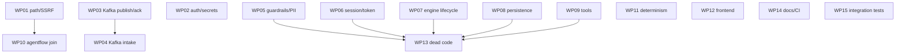

# TODO — Work packages to resolve the review

This directory contains the **work packages (WP)** derived from [`../Review.md`](../Review.md).
Each WP is scoped so it can be worked on **independently** and **documented in the same file**
(progress log at the end).

## Ground rule: tests first, then changes

Every WP follows the same flow:

1. **Tests first (Red).** Check/extend existing tests, write new test cases for the misbehaviour.
   They must **fail first** (or pin down today's misbehaviour).
2. **Change (Green).** Minimal implementation until the tests are green.
3. **Verification.** Module tests + affected neighbouring modules + integration tests if needed.
4. **Docs.** Changelog in the WP file, update README/docs if required.

> **References** (`Bxx`, `Axx`, `Cxx`, `§x`) refer to `../Review.md`.

## Status overview

| WP | Title | Severity | Modules | Depends on | Status |
|----|-------|----------|---------|------------|--------|
| [WP01](WP01-security-path-confinement.md) | Security: path confinement & SSRF | Critical | quad-quarkus | – | done |
| [WP02](WP02-security-auth-secrets-compliance.md) | Security: auth, secrets, compliance | High | kafka-platform, agentflow-ui | – | done |
| [WP03](WP03-kafka-publish-ack-worker-config.md) | Kafka: publish/ack & worker config | Critical | kafka-platform | – | done |
| [WP04](WP04-kafka-intake-event-contract.md) | Kafka: intake/event contract | Critical | kafka-platform | – | done |
| [WP05](WP05-quad-core-guardrails-pii-observability.md) | quad-core: guardrails, PII, observability | Medium | quad-core | – | done |
| [WP06](WP06-quad-core-session-token-state.md) | quad-core: session, token, state | Medium | quad-core | – | done |
| [WP07](WP07-workflow-engine-execution-lifecycle.md) | Workflow engine: execution & lifecycle | Medium | quad-quarkus | – | done |
| [WP08](WP08-persistence-config-robustness.md) | Persistence & config robustness | Medium | quad-quarkus | – | open |
| [WP09](WP09-tool-hardening.md) | Tool hardening | Medium | quad-quarkus | WP01 (containment helper) | open |
| [WP10](WP10-agentflow-generator-join.md) | agentflow: consolidate generator & join | High | agentflow, quad-quarkus | WP01 (test locations only) | done |
| [WP11](WP11-agentflow-determinism-request-context.md) | agentflow: determinism & request context | High | agentflow | – | done |
| [WP12](WP12-frontend-quad-ui-agentflow-ui.md) | Frontend: quad-ui & agentflow-ui | Medium | quad-ui, agentflow-ui | – | open |
| [WP13](WP13-remove-dead-code.md) | Remove dead code | Medium | all | after WP05–WP11 | open |
| [WP14](WP14-docs-consolidation-ci.md) | Consolidate docs & CI | Medium | kafka-platform, root | – | open |
| [WP15](WP15-integration-tests-hardening.md) | Harden integration tests | Medium | integration-tests | – | open |

**Status legend:** `open` · `in progress` · `blocked` · `test red` · `done`

## Recommended processing order



**Waves:**

1. **Wave 1 – security & correctness (critical/high):** WP01, WP02, WP03, WP04, WP10, WP11.
2. **Wave 2 – robustness & hygiene (medium):** WP05, WP06, WP07, WP08, WP09.
3. **Wave 3 – cleanup & process:** WP12, WP13, WP14, WP15 (WP13 only after waves 1+2).

WP13 (dead code) comes **last**, so we do not delete code that an earlier WP still needs to touch.

## Test/build commands (quick reference)

```bash
# Root reactor (everything, correct order)
mvn -T1C clean install

# quad-quarkus submodules
cd quad-quarkus && mvn -pl quad-core test
cd quad-quarkus && mvn -pl quad-workflow-engine test
cd quad-quarkus && mvn -pl quad-workflow-core test
cd quad-quarkus && mvn -pl quad-quarkus test

# kafka-platform
cd kafka-platform && mvn -pl agent-common test
cd kafka-platform && mvn -pl agent-orchestrator test
cd kafka-platform && mvn -pl quad-workflow-worker test
# from the root (resolves quad-core from the reactor):
mvn -pl kafka-platform/agent-orchestrator -am test

# agentflow
cd agentflow && mvn -pl agentflow-app test

# Frontends
cd quad-quarkus/quad-ui && npm test
cd agentflow/agentflow-ui && npm test

# Integration tests (own reactor)
cd integration-tests && ./scripts/run-integration-tests.sh e2e
```

## Progress-log conventions

Per WP, at the end of the file:

```markdown
## 2. Configurable ports -> done
- Test: `TestEnvTest#defaultsResolvable` (green)
- Docs: README §Ports updated

## Progress log

| Date | Author | Step | Result |
|------|--------|------|--------|
| 2026-10-20 | @torsten | 2.4 implemented | quad-workflow-worker: 41 tests green |
```

## Recurring points that apply to (almost) every WP

- **No CI for `quad-quarkus`/`agentflow`** (A4) → see WP14; until then run `mvn test` locally before every commit.
- **Swallowed exceptions / `System.out`** are cross-cutting patterns → fix them in the relevant WP where possible, no dedicated package.

## Deliberately NOT included in this backlog (low severity, §5.4 in Review.md)

Redis key typo `email:initator:` was fixed in WP04, `JournalService` default, `Clock` ignorance,
`AutoScalingService` unused bits, `GuardrailFactory` regex. These can be pulled separately as "good first issues".
